# Demos

Trainers and inference exes that ride on the chapter nets. The trainers under `apps/` are the
chapters themselves (linear, MLP, CNN, CIFAR-BN, ResNet, MobileNet, EfficientNet, ConvNeXt, ViT).
These take the same codegen path into the domains Chapters 11–13 of the book walk: recognition
(detection, industrial inspection, people, agriculture, remote sensing, segmentation), then beyond
it (language, diffusion, image synthesis, physics, signal processing, a quantum ground state, a
protein's shape), and last the games (Pong, Leduc poker, tic-tac-toe). The sections below follow
the chapters' order. Almost nothing here changes the codegen: a demo is the ordinary train step on
a new input, loss or host loop, and the few new layers are named where they appear.

Each section has the same shape: the question, the bracket it is scored inside, the result, the
one lever that mattered, and what the demo is not. The working detail (every arm, every seed, the
gates) is in the run directory the section ends on. Every figure is redrawn by its script
in [`scripts/demos/`](../scripts/demos/) (`*_figure.py`, `*_render.py`), each with its usage in its docstring.

Run any demo by short name with `lake run demo <group> [entry] [args…]`. `lake run demo` lists the
groups; `lake run demo ttt alphazero n=4` builds and runs `alphazero-ttt n=4` under XLA and tees
its transcript to `runs/<date>-<exe>/`. The GPU is `$LEAN_DEMO_GPU` (default 0). `lake exe <name>`
still runs any of them directly. The ImageNet-bootstrapped demos need the relevant chapter
trainer's checkpoint first.

---

## Object detection — R34+FPN on VisDrone

**The question.** Can a detector built from this stack's own parts find seventy small objects in
a drone frame? The backbone is a ResNet-34 trained by this stack on ImageNet. It feeds an FPN neck
into three anchor heads at strides 8/16/32, with a DIoU box loss, focal objectness and focal class
cross-entropy, at 448 px over VisDrone's ten classes. A median VisDrone image holds 70 objects,
many of them 2–5 px after the resize, which is the regime where one coarse grid cannot work.

```bash
./scripts/datasets/download_visdrone.sh
# write the anchor priors from the values hardcoded in the demo; do NOT re-run k-means
python3 scripts/datasets/preprocess_visdrone.py data/visdrone data/visdrone_fpn \
    --size 448 --grid 14 --fpn data/visdrone
python3 scripts/datasets/preprocess_visdrone.py data/visdrone data/visdrone448 --size 448 --grid 14

# the recipe, ~2 h on one RTX 4060 Ti
FPN_BACKBONE=r34 FPN_TAG=run1 FPN_AUG=1 FPN_CLSW=none FPN_CLSFOCAL=2 FPN_AFFINE=50 FPN_EPOCHS=30 \
  lake run demo yolo visdrone data/visdrone_fpn
FPN_BACKBONE=r34 FPN_TAG=run1 lake run demo yolo visdrone infer data/visdrone_fpn runs/fpn_run1
python3 scripts/demos/yolo_map_visdrone.py runs/fpn_run1/logits.bin \
    data/visdrone448/val.bin --fpn data/visdrone --grid 14 \
    --multilabel --topk 3000 --ml-k 3 --ml-floor 0.05
```

Three settings fail silently. `FPN_TAG` must be set on `infer` too, or the eval loads another
arm's weights. `FPN_BACKBONE` defaults to `r50`. `--topk` defaults to 1000, which truncates the
multilabel candidate list.

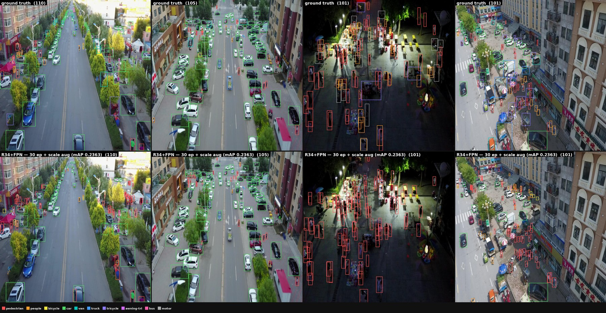

Ground truth above, the detector's boxes below, on four validation frames. Box color is the class.

**The bracket.** A YOLOv8s at the same budget scores 0.140. Its published-style 0.391 comes from
8× the epochs, higher resolution, full augmentation and COCO pretraining. A PyTorch replica of
this architecture scores 0.1532 under 12 epochs, no augmentation and argmax decode; the Lean
trainer on that recipe and decode scores 0.151 ± 0.004. The implementation is level with its twin
([`visdrone/`](visdrone/) holds both references).

**The result.** mAP@0.5 = **0.232 ± 0.004** over three seeds at 30 epochs under the multilabel
decode (recall 0.769, class-agnostic AP 0.482). It runs at 65 fps on one RTX 4060 Ti and at
55.9 fps on a 25 W Jetson Orin Nano under TensorRT (`deploy/ORIN.md`), which is the deployment
this dataset implies.

**The lever** is augmentation that changes object scale, together with the schedule it needs. The
two are one decision. Without augmentation a 50-epoch run scores 0.129 ± 0.001, under the 12-epoch
0.157 ± 0.004. With HSV jitter and flip, 50 epochs is flat at 0.170 ± 0.003. With scale
augmentation the curve climbs to epoch 28–30 and lands at 0.232.

The gain is in the per-class split. Per-class AP runs from car (0.66) to bicycle (0.036), a spread
of 18×, and scale augmentation narrowed it from 24× by lifting the worst classes most
(awning-tricycle 1.9×, tricycle 1.6×, bicycle 1.5×, car 1.1×). Aerial detection collapses on
whatever is small and rare, and an averaged mAP hides that.

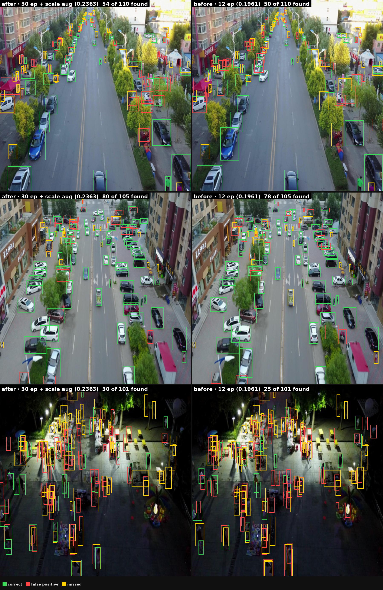

Three frames colored by correctness: green hit, red false positive, yellow missed ground truth.
The 30-epoch arm is on the left and the 12-epoch arm on the right.

**What this is not:** a competitive VisDrone entry. Scale augmentation closes 0.07 of the 0.23
between the matched 12-epoch row and the field's number; the rest is recipe this demo does not run.

Detail: `runs/2026-10-27-visdrone-rows-seeds/`, `runs/2026-10-27-visdrone-aff30-seeds/`,
`planning/archive/visdrone_detector.md`.

---

## Industrial inspection — the same detector on NEU-DET steel defects

**The question.** When does multi-scale detection pay? The VisDrone detector runs unchanged
(backbone, neck, heads, loss, bootstrap, scorer) on NEU-DET: 1,800 grayscale 200×200 crops of
hot-rolled steel, six defect classes. It is VisDrone's opposite regime, with 2.3 defects per crop
and half of them spanning more than half the frame. 98% of NEU's boxes route to the coarsest
level, so a single 14×14 grid should hold up here. Running both heads on both datasets shows where
the neck earns its place.

```bash
./scripts/datasets/download_neu.sh       # 26 MB; fits anchors; writes both record formats

# the FPN arm; the VisDrone recipe's flags are this binary's defaults; ~25 min on one 4060 Ti
FPN_TAG=run1 lake run demo yolo neudet data/neu_det_fpn
# the single-grid arm beside it, same epochs
YOLO_TAG=run1 YOLO_EPOCHS=30 lake run demo yolo neudet448 data/neu_det448

# every saved epoch, inferred and scored, then the table's row at the val-peak epoch
scripts/sweeps/neudet_eval_sweep.sh fpn  run1 0 val
scripts/sweeps/neudet_eval_sweep.sh grid run1 1 val
scripts/sweeps/neudet_eval_sweep.sh fpn  run1 0 test "28"
```

Against the VisDrone binary only the anchor priors (k-means on NEU boxes), the class weights (off)
and the class count change. `FPN_TAG` still has to be set on `infer`.

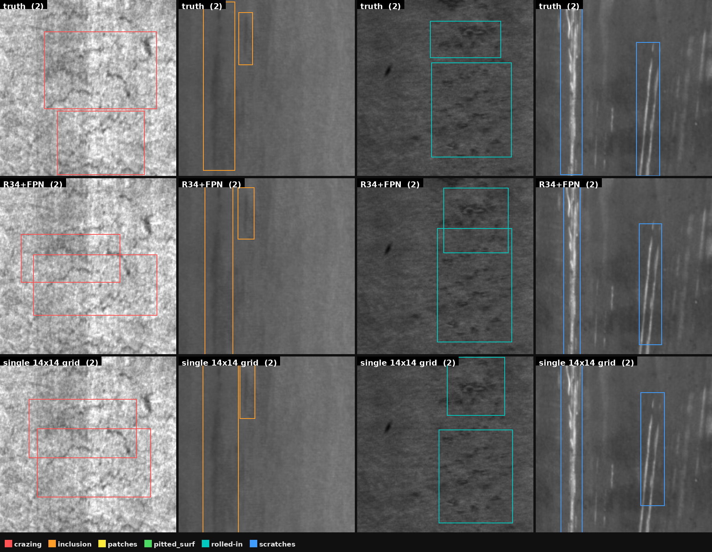

Truth, R34+FPN and the single grid on a crazing, inclusion, rolled-in-scale and scratches crop.

NEU-DET test (360 images), each arm at its val-peak epoch, three seeds an arm:

| arm | mAP@0.5 | recall | class-agnostic AP |
|---|---|---|---|
| **R34+FPN**, VisDrone recipe | **0.632 ± 0.008** | 0.992 ± 0.001 | 0.640 ± 0.013 |
| R34+FPN, HSV+hflip off (affine kept) | 0.646 ± 0.015 | 0.991 ± 0.004 | 0.659 ± 0.017 |
| R34+FPN, no ImageNet bootstrap | 0.562 ± 0.012 | 0.986 ± 0.001 | 0.567 ± 0.014 |
| **R34 single grid 14×14** | **0.609 ± 0.018** | 0.923 ± 0.008 | 0.606 ± 0.027 |
| published stock detectors, 640 px, 300 ep | 0.73–0.78 | | |
| published improved variants | ~0.83 | | |

**The result.** On steel the grid head is within 0.02 of the FPN and behind on every seed. On
VisDrone val the same two heads score 0.232 ± 0.004 and 0.0391: the grid is six times behind, with
recall 0.184 against 0.769. Backbone, bootstrap, scorer and lowerer are the same in all four
cells. Multi-scale detection pays where objects are small. On NEU the neck runs three heads for
one level's work.

**The lever** on this dataset is the ImageNet prefix, worth +0.071 ± 0.011 at 1,080 training
images with the same sign on all three seeds. Switching HSV jitter and flip off is +0.014: the
crops are gray and the affine does the work.

Recall is 0.99, so the number is ranking, and it is two classes. Crazing (0.34) and rolled-in
scale (0.43) are diffuse textures whose "box" is most of the crop, and they are worst for both
heads on every seed, as they are in every NEU paper.

**What this is not:** the published protocol. The gap to the published rows is schedule,
resolution and split before it is architecture.

Detail: `runs/2026-09-17-neudet-fpn-run1/README.md` (its Table 2 is the VisDrone single-grid
row), `runs/2026-10-27-neudet-seeds/`, `planning/neu_det_fpn_demo.md`.

---

## People watching — the chapter-4 CNN on Arabic sign-language letters, under two splits

**The question.** What is the literature's 96–99.6% on ArASL measuring? ArASL is 54,049 gray 64×64
crops of hands spelling the 32 letters of the Arabic alphabet (Latif et al. 2019, CC BY 4.0). The
images are video bursts: 73.5% of consecutive files differ by under 6 gray levels, and the release
records no signer. So Chapter 4's `CIFAR-CNN8-wide-BN`, with a one-channel stem and a 32-way head,
is trained twice on the same images: under the literature's random split, and under a blocked
split that keeps each class's capture order together. A leak audit finds, for every test image,
its nearest training image.

```bash
./scripts/datasets/download_arasl.sh     # Mendeley, sha256-checked; writes both splits and the leak audit

# the chapter net under each split, ~5.5 min per run on one 4060 Ti
lake run demo signs net=cifar8w split=random  seed=1 tag=s1 out=runs/x
lake run demo signs net=cifar8w split=blocked seed=1 tag=s1 out=runs/x
# the bracket: net=mlp | net=linear, and the chapter's own 32×32 input with size=32

python3 scripts/demos/arasl_score.py runs/x/arasl_cifar8w_blocked_s{1,2,3}_logits_test.bin \
    --split=blocked --top 8 --json runs/x/score.json
```

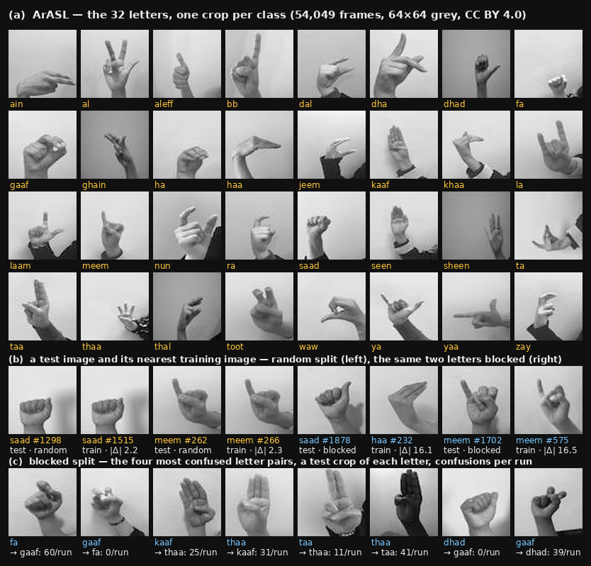

ArASL test (80/10/10 per class), at the val-peak epoch, three seeds for the chapter net:

| arm | random split | blocked split | |
|---|---|---|---|
| **CIFAR-CNN8-wide-BN**, 64×64 | **98.62** ± 0.10 | **77.94** ± 0.80 | the demo |
| — on test images with a near-duplicate in train | 99.73 | 98.46 | 92.3% / 6.4% of the test tenth |
| — on the rest | 85.26 | 76.53 | |
| CIFAR-CNN8-wide-BN at 32×32 | 98.21 | 71.03 | the chapter's own input |
| MLP 4096-512-512-32 | 94.86 | 42.09 | |
| linear 4096-32 | 53.20 | 15.37 | |
| 1-NN on 16×16 thumbnails | 95.65 | 28.60 | no parameters |
| published CNNs, random split | 96.6–97.6 | — | |
| published transfer / ViT, random split | 99.3–99.6 | — | |

**The result.** The published number is mostly the frame. Nine in ten random-split test images
have a training image within 6 gray levels. The net scores 99.7% on those and 85.3% on the rest,
and a nearest-neighbor lookup with no parameters already gets 95.7%. Keep each hand's frames on
one side of the line and the same net, recipe and seeds score 77.9%.

**The lever** is the split, and nothing about the model. The bracket shows who was leaning on the
leak: between the columns the linear model loses 38 points, the MLP 53 and the convolutions 21.
Per class the blocked column runs from 16.5% (`fa`) to 100% (`sheen`), and `fa` is read as `gaaf`
181 times in three runs against once the other way.

**What this is not:** a signer-independent number. The blocked split is a proxy. Its validation
tenth is 37.5% leaked, because it neighbors train in capture order, so every blocked log shows
val near 92% and test near 78%. About 6% of test hands return from earlier in the numbering.

Detail: `runs/2026-09-17-arasl/README.md`, `planning/arasl_people_watching_demo.md`.

---

## Agriculture — chapter 5's ResNet-34 from lab leaves to field leaves

**The question.** Does a 99% plant-disease classifier work on a plant in a field? Chapter 5's
ResNet-34, from the ImageNet prefix with a 38-way head, trains on PlantVillage: 54,305 lab
photographs of single picked leaves on a gray background (Mohanty et al. 2016, CC BY-SA 3.0). The
same weights are then scored on PlantDoc: 2,578 field photographs of the same crops, whose 28
classes all map into PlantVillage's 38 (Singh et al. 2020, CC BY 4.0). Three explainers say where
the evidence was: the closed-form CAM, an exact two-player Shapley value (leaf against
background), and counterfactual images of the same leaves on other backgrounds.

```bash
./scripts/datasets/download_plant.sh     # two clones (4.8 + 1.9 GB), split lists, masks, composites

# the base arm under the leaf-grouped split, ~40 min on one 4060 Ti; scores PlantVillage test,
# its four counterfactuals and all of PlantDoc in one run
lake run demo plant-leaf split=grouped train=base init=imagenet seed=1 tag=s1 out=runs/x
python3 scripts/demos/plant_score.py runs/x/plant_resnet34_grouped_base_imagenet_s1_logits_pd_all.bin --part pd_all --restrict

# the CAM of every test image, and the exact two-player Shapley value
lake run demo plant-leaf split=grouped train=base init=imagenet seed=1 tag=s1 out=runs/x eval cam=1
python3 scripts/demos/plant_cam.py runs/x/plant_resnet34_grouped_base_imagenet_s1_cam_pvg_test.bin --split pvg
python3 scripts/demos/plant_shapley.py two-player --split pvg --logits runs/x/plant_resnet34_grouped_base_imagenet_s1

# the fixes: train=comp (leaves on Imagenette backgrounds) | train=aug | field=<fold> from a checkpoint
lake run demo plant-leaf split=grouped train=comp init=imagenet seed=1 tag=s1 out=runs/x
lake run demo plant-leaf split=grouped init=runs/x/plant_resnet34_grouped_base_imagenet_s1 field=0 fieldn=250 epochs=5 out=runs/x
```

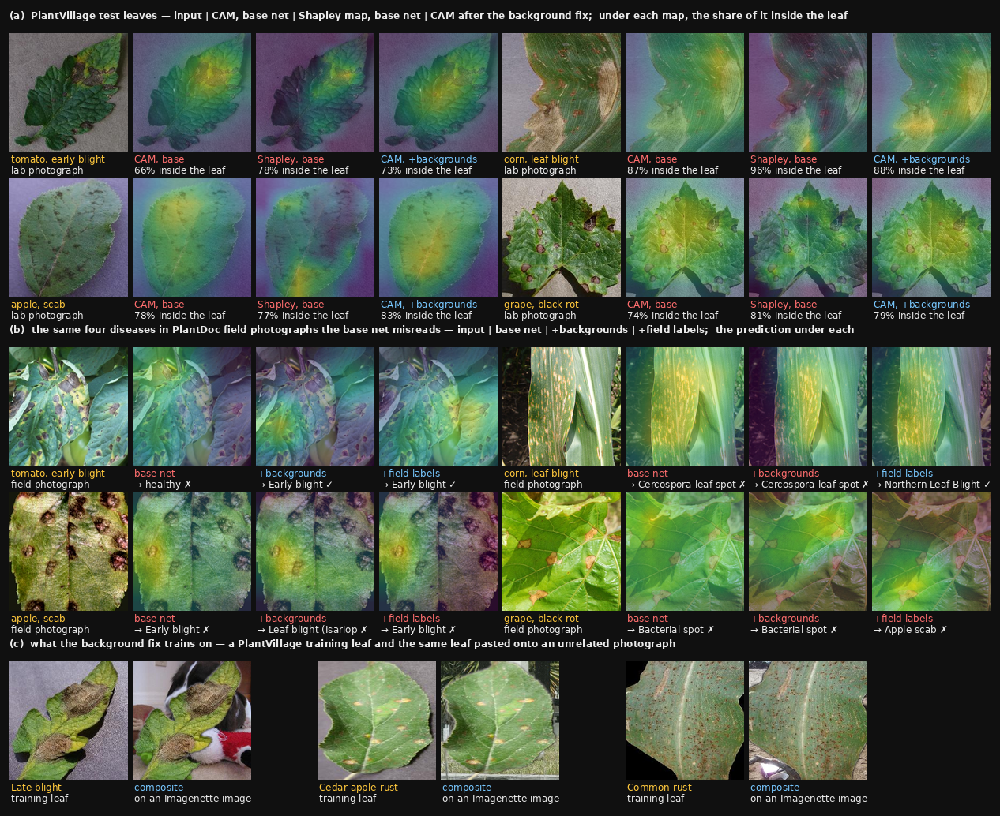

All 2,578 PlantDoc images, argmax over the 28 mapped classes; PlantVillage is the maintainers'
10,709-image grouped test:

| arm | PlantVillage | PlantDoc |
|---|---|---|
| **ResNet-34, ImageNet prefix**, 3 seeds | **99.57 ± 0.06** | **17.80 ± 1.77** |
| — random split (the papers' protocol) | 99.72 | 16.56 |
| — from scratch | 99.07 | 11.60 |
| + every training leaf also on an Imagenette background, 3 seeds | 99.44 ± 0.15 | 21.48 ± 1.25 |
| + photometric + geometric augmentation | 99.62 | 19.24 |
| + 250 field labels, 5-fold | — | 22.69 |
| + all field labels (2,062 per fold), 5-fold | — | **45.00** |
| + backgrounds, then 250 / all field labels | — | 26.57 / 42.05 |
| published, random split / other conditions | 99.35 | ≈ 31 |

**The result.** The lab number reproduces and the field number is 17.80%. The diagnosis is the
background. Put the same test leaves on black and the base net falls to about 60%. A flat image of
the background color alone scores 4.4% against a chance of 2.6%, and the background's marginal
contribution is positive for 88.2% of test images.

The two attribution maps disagree with that. Shapley gives the leaf 85.0% of the class logit and
70.9% of the CAM's mass sits inside the leaf mask. Both say "mostly the leaf", while the
counterfactuals say the background is decisive anyway. Saliency is not sensitivity.

**The lever** is field data. Training every leaf on Imagenette backgrounds as well moves every
diagnostic the right way (leaves on black go to 96.3%) and the field number by 3.7 points. Two
thousand field labels move it by 27. The two fixes stack at 250 labels and not at 2,062.

**What this is not:** a split problem. The ArASL leak audit finds PlantVillage pixel-clean (1.3%
of random-split test images have a near-twin), and grouping by leaf does not move the lab number
(99.57 against 99.72). The laboratory was the leak.

Detail: `runs/2026-09-17-plant/README.md`, `planning/plant_lab_to_field_demo.md`.

---

## Remote sensing — the chapter-4 CNN on thirteen Sentinel-2 bands, from Europe to Brazil

**The question.** Which wavelengths travel? Chapter 4's CIFAR-CNN8-wide-BN trains on EuroSAT:
27,000 Sentinel-2 chips over 34 European countries, 64×64 at 10 m, all 13 bands from 443 to
2190 nm, ten land-cover classes (Helber et al. 2019, MIT). It trains five times with a different
part of the spectrum at the stem: `rgb`, `rgbn` (+ NIR), `ms10` (the 10 m and 20 m bands), `all`,
and `ir` (red edge, NIR and SWIR, no visible light). The same weights are then scored, unchanged,
on chips cut for this demo from Sentinel-2 L1C scenes over Rondônia (June) and western Bahia
(September, and the same chips in March), labeled from MapBiomas Collection 4 (CC BY 4.0) through
the seven classes the two continents share.

```bash
./scripts/datasets/download_rs.sh        # EuroSAT MS (2 GB) + torchgeo's split lists

# an arm on EuroSAT, 80 epochs, ~5 min on one 4060 Ti; five arms × three seeds is the table
lake run demo rs-bands arm=all epochs=80 seed=1 tag=s1 out=runs/x
.venv-rs/bin/python scripts/demos/rs_score.py runs/x/rs_cifar8w_all_s1_logits_eurosat_test.bin --part eurosat_test

# the Brazil chips (a free CDSE account; keys in the environment; ~8 GB of scenes once)
export CDSE_S3_ACCESS_KEY=… CDSE_S3_SECRET_KEY=…
.venv-rs/bin/python scripts/datasets/preprocess_rs_brazil.py --tiles 6 --cands 1500 --cap 2000
.venv-rs/bin/python scripts/datasets/rs_folds.py

# the same weights on the Brazil parts, the wet/dry pair, the tables
lake run demo rs-bands arm=all eval tag=s1 out=runs/x score=amazon_dry,cerrado_dry,cerrado_wet
.venv-rs/bin/python scripts/demos/rs_score.py runs/x/rs_cifar8w_all_s1_logits_cerrado_dry.bin --part cerrado_dry \
    --pair runs/x/rs_cifar8w_all_s1_logits_cerrado_wet.bin --pair-part cerrado_wet
.venv-rs/bin/python scripts/demos/rs_table.py runs/x

# five-group Shapley (32 coalitions, exact)
.venv-rs/bin/python scripts/demos/rs_shapley.py make --part amazon_dry --n 300
lake run demo rs-bands arm=all eval tag=s1 out=runs/x score=shap_amazon_dry
.venv-rs/bin/python scripts/demos/rs_shapley.py score --part amazon_dry --logits runs/x/rs_cifar8w_all_s1_logits_shap_amazon_dry.bin
```

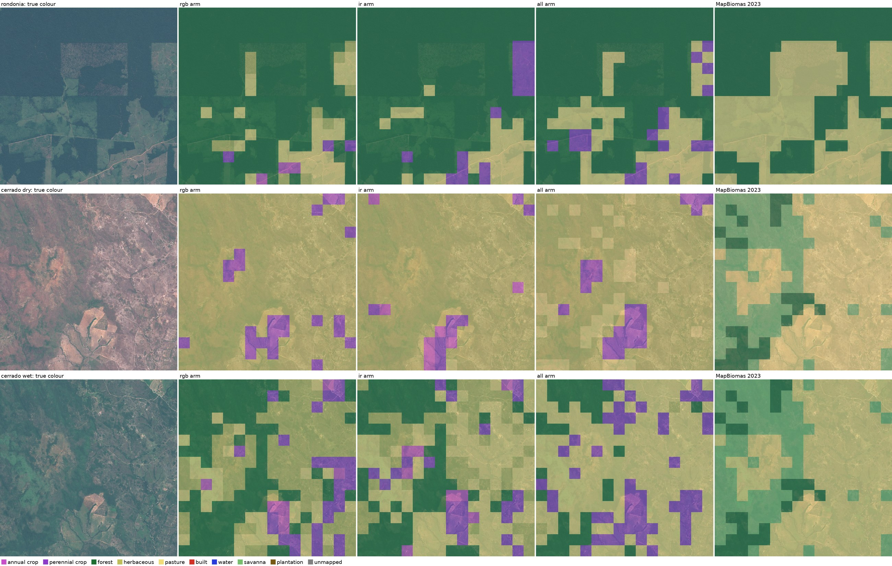

Rows: Rondônia in June, western Bahia in September, the same window in March. Columns: the scene
in true color, then the 640 m chip grid colored by the `rgb`, `ir` and `all` arms' predictions,
then MapBiomas 2023.

**The result.** In Europe the invisible bands are worth a point. In the Amazon they are worth ten,
and pasture recall goes from 74 to 95. In the dry Cerrado every arm fails on the seven-class map:
a September paddock is "herbaceous" to a European net, and savanna has no European name. No arm is
stable across the seasons. The `rgb` arm turns a third of the Cerrado to "forest" between
September and March.

**The lever** is which bands the stem sees, and more is not simply better. A five-player exact
Shapley value over band groups says the three atmospheric bands carry Europe's atmosphere: their
value is negative in Brazil. That is why the ten-band arm travels best.

**What this is not:** a land-cover map of Brazil. The nets never train on a Brazilian chip in the
headline rows, and the tables with every arm, season and seed are in the run directories.

Detail: `runs/2026-09-29-rs-phase1/`, `runs/2026-09-29-rs-phase2/` (how the Brazil chips were
made), `runs/2026-09-29-rs-phase3/`, `planning/remote_sensing_wavelengths_demo.md`.

---

## Semantic segmentation — a ResNet-34 UNet on BraTS

**The question.** What do the skip connections buy, and what does an ImageNet backbone buy, on a
medical dataset of ordinary size? Chapter 5's ResNet-34 is reused verbatim as the contracting path
under a UNet decoder, on MSD Task01_BrainTumour: 224×224 axial slices, four co-registered MRI
modalities, four tumor classes. 24.5M parameters, plain per-pixel cross-entropy, 10 epochs.

```bash
./scripts/datasets/download_brats.sh
python3 scripts/datasets/preprocess_brats.py data/brats/Task01_BrainTumour data/brats224 \
        --size 224 --seed 0 --val-full
./scripts/sweeps/run_brats_r34_ab.sh 10 data/brats224             # both arms, one per GPU, ~50 min
lake run demo brats predict net=r34 arm=scratch,r34 best out.ppm  # best-by-val checkpoints
lake run demo brats eval net=r34 arm=r34 best out=pervol.csv      # per-patient Dice
```

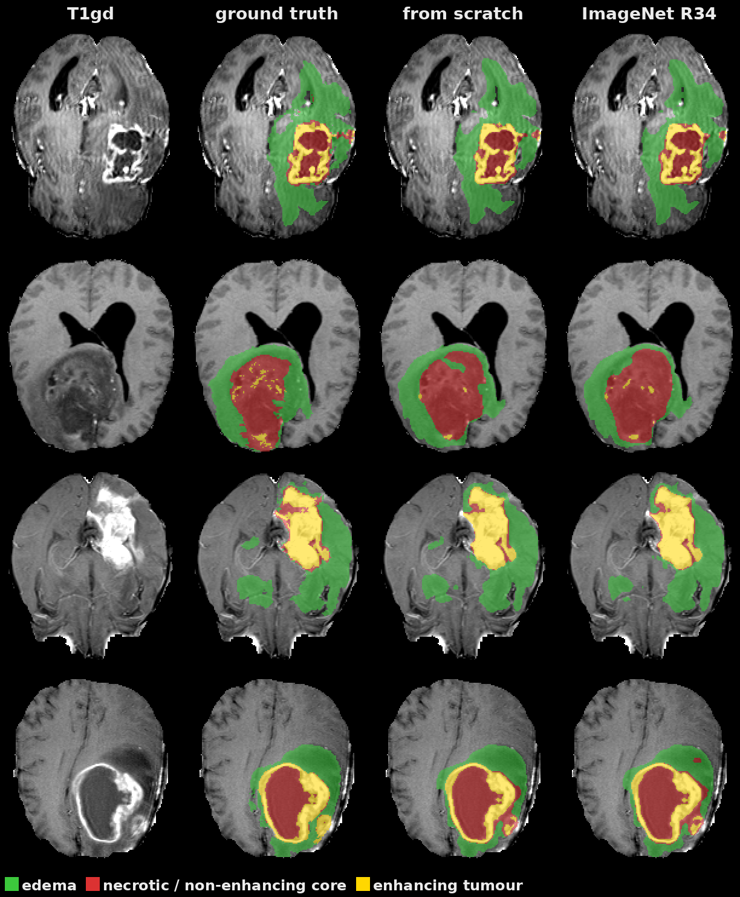

One held-out patient per row: the T1gd slice, the ground truth, and each arm's prediction.
Background is 97% of the voxels, which is why the picture carries more than pixel accuracy does.

Each seed's best-by-val checkpoint, 2,569 held-out slices from 73 patients, pooled, three seeds:

| arm | mIoU | WT | TC | ET |
|---|---|---|---|---|
| `r34` (ImageNet bootstrap) | 0.741 ± 0.002 | 0.912 ± 0.001 | 0.867 ± 0.004 | 0.856 ± 0.003 |
| `scratch` (He-init) | 0.737 ± 0.004 | 0.909 ± 0.002 | 0.864 ± 0.005 | 0.855 ± 0.001 |

**The result.** mIoU 0.741. Scored the way BraTS papers score, one Dice per patient over the whole
volume and the mean over 73 patients, the `r34` arm is 0.893 / 0.821 / 0.790 on whole tumor, tumor
core and enhancing tumor. That is two to seven points below the pooled numbers, because a tail of
small-tumor patients pulls the means down.

**The lever** is the skips, and they are worth ten points. Same backbone and schedule, decoder
with and without the encoder concat, three seeds a side: 0.634 ± 0.003 → 0.737 ± 0.004 mIoU. The
largest gain is on enhancing tumor (+0.124 ± 0.003), the thinnest structure. A skipless decoder
has to rebuild every boundary from a 7×7 bottleneck. Run the ablation with `noskip`.

Transfer buys far less: +0.004 mIoU on average, the same sign on every seed and about the size of
one arm's seed spread. At epoch 1 the arms are equal. Transfer's payoff shrinks as the dataset
grows, and 14,415 slices is a lot. The backbone is `.lake/build/jax_r34_imagenet.bin`, trained by
this stack to 72% top-1; nothing is downloaded. Its stem is RGB and BraTS needs four channels, so
`bootstrapBackboneRange` patches a byte range and leaves the fresh stem He-initialized.

Through-plane context was measured two ways. Feeding the slices above and below as extra channels
(`ctx=1`) ties the 2D net within 0.005 on every metric. A 3D UNet trained in JAX is ahead per
patient by 0.009 on whole tumor and tumor core, and raises a false enhancing-tumor alarm on under
half as many slices (1.07% against 2.49%).

**What this is not:** a 3D segmenter. The Lean trainer here is the slice model; the rank-5 port is
not built.

Detail: `runs/2026-09-25-brats-r34-xla/`, `runs/2026-10-27-brats-r34-seeds/`,
`runs/2026-09-29-brats-25d/`, `runs/2026-10-03-brats-3d/`, `planning/brats_25d_3d.md`.

---

## Natural language processing — TinyGPT on Shakespeare

**The question.** Does a small transformer beat counting on its own corpus? A character-level
transformer trains on Karpathy's tinyshakespeare. Three codegen primitives carry it:
`tokenPositionEmbed`, `lmHead`, and the `causalMask` flag on `transformerEncoder`. `nano` is 212K
parameters (T=64, D=64, 4 layers, 2 heads) and `tiny` is 1.2M (T=128, D=128, 6 layers, 4 heads).
10K Adam steps at batch 32 take about 3 min and 6½ min on one RTX 4060 Ti.

```bash
./scripts/datasets/download_shakespeare.sh
python3 scripts/datasets/preprocess_shakespeare.py                # train.bin / val.bin / vocab.txt
lake run demo shakespeare gpt train nano 10000
lake run demo shakespeare gpt train tiny-do20 10000               # tiny with residual dropout 0.2
lake run demo shakespeare gpt sample nano 600 80 0 100 1 "ROMEO:" # 600 chars, temp 0.8, seed 1
# the count-based rows: scripts/demos/ngram_ladder.py (fit, then score), seconds on CPU
```

```text
ROMEO:
O heaven farewell, upon thy hands.

NORTHUMBERLAND:
Then with clearing too forpully of his,
You are would not we love I have,
Which of you have I do foeble thy true king with odds
To desire her furrow'd the victory,
```

Real character names, a Romeo named inside another speaker's line, dialog with cadence and
punctuation. Coherence drops past the 64-character window.

**The bracket** is the n-gram ladder fit on the training split. Bits per character on the held-out
split, every position predicted from the full window before it, three seeds a transformer row:

| arm | steps × batch | bits/char, seeds 0 / 1 / 2 | mean gap to the 7-gram |
|---|---|---|---|
| uniform over 65 characters | — | 6.022 | |
| Kneser-Ney bigram | — | 3.583 | |
| Kneser-Ney 7-gram, the best order | — | 2.188 | |
| `nano`, 212K | 10k × 32 | 2.244 / 2.228 / 2.226 | +0.044 |
| `nano` | 40k × 32 | 2.302 / 2.290 / 2.274 | +0.100 |
| `nano`, RoPE, no position table | 10k × 32 | 2.221 / 2.225 / 2.215 | +0.032 |
| `tiny`, 1.2M | 10k × 32 | 2.809 / 2.807 / 2.799 | +0.616 |
| `tiny`, residual dropout 0.1 | 10k × 32 | 2.132 / 2.141 / 2.154 | −0.047 |
| **`tiny`, residual dropout 0.2** | 10k × 32 | **2.126 / 2.132 / 2.120** | **−0.063** |

**The result.** Every transformer trained the way a catalog prints it is behind a six-character
count on its own corpus. `nano` trails on every seed, and more steps or rotary positions move it
by hundredths without changing the sign. `tiny`, with nearly six times the parameters, has
memorized the 1 MB file by step 4,000 and is worse still. The nets were unregularized.

**The lever** is one knob: `.transformerEncoder (dropout := 0.2)`, GPT-2's residual dropout on
each block's two branches. It puts the same `tiny` at the same 10,000 steps 0.06 bits/char ahead
of the 7-gram on every seed. The net is behind the counts at histories under ten characters and
ahead from the eleventh on, which is the history a 7-gram cannot see.

**What this is not:** a language model at any useful scale, or a length-general one. The RoPE net
loads at any T and is not coherent at 128 or 256 (3.1 and 4.9 bits/char). The 2.28 in the
sampler's log is `nano`'s chunked scoring; the table's streaming pass is the comparable number.
`bigram-shakespeare` (`lake run demo shakespeare bigram`) is a smoke test of the data pipeline.

Detail: `runs/2026-10-21-tinygpt-ngram-ladder/`, `runs/2026-10-27-tinygpt-ladder-xla/`,
`runs/2026-10-27-tinygpt-dropout-xla/`, `planning/archive/tinygpt_demo_v2.md`.

---

## Diffusion — DDPM on MNIST

**The question.** How do you score a generator without squinting at it? A tiny UNet (base 16, 50
epochs) predicts the noise added to an MNIST digit, and sampling runs that prediction backwards:
cosine schedule, ancestral sampling (DDIM at η = 1) with 50 steps subsampled from T = 1000. Time
conditioning is a tiled `t/T_max` input channel, so it needs no new codegen.

```bash
lake run demo ddpm train                                    # 50 epochs
lake run demo ddpm sample runs/mnist_samples.ppm            # 4×4 grid, ancestral; eta=0 for deterministic DDIM

LEAN_MLIR_DUMP_PARAMS=.lake/build/cnn_verified_params.bin \
  lake exe mnist-cnn-verified data                          # the scorer's classifier, ~50 s
lake run demo ddpm score 1024 50                            # 1024 samples, 50 steps, ancestral, ~13 s
lake run demo ddpm score 1024 50 0                          # the same at η = 0
python3 scripts/demos/mnist_ddpm_score.py                   # exits non-zero below 10/10 coverage
```

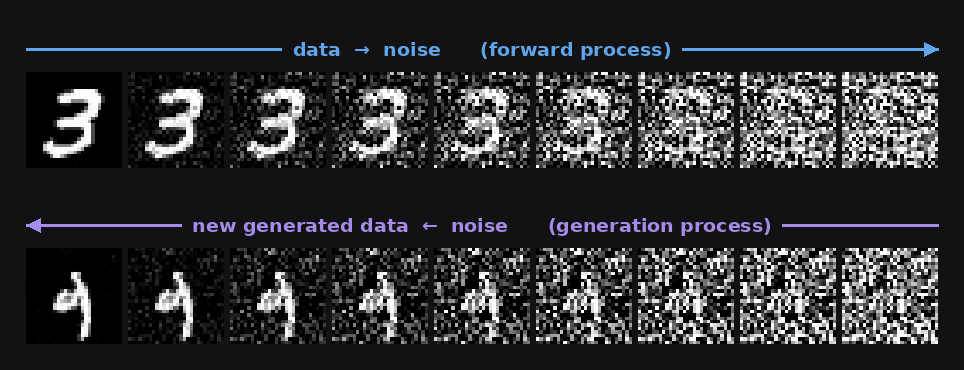

Top: the forward process on a real training digit. Bottom, read right to left: the reverse process
from fresh noise, which condenses into a different digit. The two rows are aligned by noise level,
so a column compares a real digit that corrupted with what the model recovers from that much noise.

**The bracket.** Chapter 3's verified CNN (98.66% on the real test split) classifies 1024 samples.
They are scored on class coverage, classifier confidence, and energy distance to 1024 real images
as a multiple of the real-against-real floor. Real MNIST scored as if generated is the ceiling and
unstructured pixels with MNIST's moments are the floor.

| arm | sampler (50 steps) | coverage | confidence | energy (× floor) |
|---|---|---|---|---|
| real MNIST, scored as if generated | — | 10/10 | 99.40% | 1.2× |
| **50 epochs, centered to [−1, 1]** (the recipe) | **ancestral, η = 1** | **10/10** | 92.98% | **4×** |
| 50 epochs, uncentered | ancestral, η = 1 | 10/10 | **93.60%** | 6× |
| 50 epochs, centered | deterministic, η = 0 | 10/10 | 90.94% | 15× |
| 50 epochs, uncentered | deterministic, η = 0 | 9/10 | 92.82% | 33× |
| 3 epochs, centered | deterministic, η = 0 | 8/10 | 84.19% | 73× |
| 3 epochs, uncentered | deterministic, η = 0 | 9/10 | 63.89% | 119× |
| unstructured pixels with MNIST's moments | — | 4/10 | 58.47% | 231× |

**The result.** The recipe covers all ten classes at 4× the floor.

**The lever** is the sampler, and it is worth as much as the training. The same 50-epoch
checkpoint goes from 15× to 4× the floor at the same 50 network evaluations when the reverse
process re-injects noise. Ancestral sampling at 50 evaluations (energy distance 0.0067) beats
deterministic DDIM at 200 (0.0188). Epochs do most of the remaining work (3 → 50 is 3.6–4.9× on
energy) and centering the rest (1.6–2.2×).

Confidence alone would pick the wrong model. The uncentered 50-epoch arm is the more confident
under both samplers and the farther from the data under both; under the deterministic one it
drops a class. The classifier is 58% confident on noise, so its usable range starts there.

**What this is not:** an image generator at scale. It is 28×28 digits, unconditional, and the
instrument is a classifier trained on the same dataset.

Detail: `runs/2026-08-28-mnist-ddpm-verified-score/`,
`runs/2026-09-28-mnist-ddpm-ancestral-score/`, `planning/archive/ddpm_demo.md`.

---

## Image generation — low-dose CT synthesis on LIDC, held out on Mayo

**The question.** A chest CT at a tenth of the dose is noisy. Should the net that cleans it be a
regressor or a generator, and does either survive a scanner it never saw? The BraTS UNet at one
channel in and one out (7.85M parameters) is trained on LIDC-IDRI pairs as a regressor (squared
error to the scanned slice) and as a conditional generator (the MNIST DDPM's step on the residual,
with the low-dose slice as a conditioning channel, sampled by DDIM at η = 1 in 50 steps). The low
dose is simulated in the projection domain and the scanned slice is the target. Mayo's
LDCT-and-Projection-data, with the vendor's own 10% insertion, other patients, other scanners and
a sharp B50f kernel, is the held-out test.

The commands use `lake exe` because of their `--` flags; run them under
`LEAN_MLIR_LOWERER=pjrt PJRT_PLUGIN=<xla_cuda_plugin.so>`, as the run scripts do.

```bash
scripts/datasets/download_lidc.sh                        # 300 patients, ~38 GB DICOM + the XML
.venv-lidc/bin/python scripts/datasets/preprocess_lidc.py data/lidc/dicom data/lidc/xml data/lidc10 \
    --dose 0.10 --realisations 1 --workers 16            # the 10% pairs, ≈ 18 GB, ≈ 1 h on 16 cores
.venv-lidc/bin/python scripts/datasets/preprocess_mayo.py data/mayo        # 50 patients, 4,348 pairs
lake exe lidc-denoise-train data/lidc10/train.bin data/lidc10/val.bin 30000 --arm=mse --seed=0 --cosine \
    --out=runs/mse10 --dump=data/lidc10/out/mse          # 1¼ h on one card
lake exe lidc-denoise-train data/lidc10/train.bin data/lidc10/val.bin 60000 --arm=diff --seed=0 --cosine \
    --out=runs/diff10 --dump=data/lidc10/out/diff        # the generator, 2½–3 h; --target=x0 predicts the clean slice
lake exe lidc-denoise-sample data/mayo/val.bin --model=lidc10 --seed=0 --k=0 --records=records_mayo.txt \
    --dump=data/mayo/out/diff                            # DDIM η = 1, 50 steps, ≈ 1 s a slice
lake exe lidc-denoise-train data/lidc10/train.bin data/mayo/val.bin --arm=mse --seed=0 --eval-only \
    --ckpt=data/lidc10/out/mse --dump=data/mayo/out/mse --out=runs/mse10_mayo
.venv-lidc/bin/python scripts/probes/lidc_denoise_score.py data/mayo/val.bin data/mayo/out/mse/mayo_val.eps.f32 \
    --records=records_mayo.txt --by=sigma_add_hu:120,180,250,350
.venv-lidc/bin/python scripts/probes/lidc_per_slice.py data/mayo/val.bin --arms=diff.k0,mse --records=records_mayo.txt \
    --by=sigma_add_hu:120,180,250,350 --csv=perslice_mayo.csv
.venv-lidc/bin/python scripts/demos/lidc_nodules.py --data=data/lidc10 --records=records_val.txt --arms=mse,diff.k0 \
    --json=nodules_lidc10.json
.venv-lidc/bin/python scripts/demos/lidc_texture.py --data=data/lidc10 --records=records_val.txt --arms=mse,diff.k0 \
    --json=texture_lidc10.json --nps-csv=nps_lidc10.csv
```

The kernel and dose-range builds (`--filter b50f`, `--dose-range 0.03 0.25`) are in the run
directories' launch scripts.

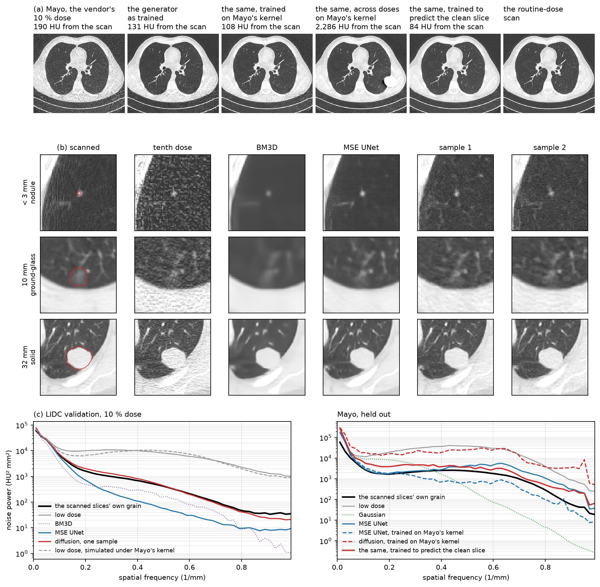

**(a)** One Mayo slice: the vendor's 10% dose, draws from four generators, the scan. **(b)** Three
validation nodules across the arms. **(c)** The radial noise power spectrum of each arm's output
against the scanned slices' own grain.

**The bracket** is three classical filters below and the scanned slice above. Scoring is body
RMSE, as the field scores, plus two things it does not: the output's grain against the scan's
own, and the contrast kept on 395 reader-outlined validation nodules. On Mayo each arm also gets a
median and the share of slices left worse than the input. 1,605 LIDC validation slices and 1,000
Mayo slices:

| arm | LIDC: RMSE HU | grain × scan | nodules kept, all / < 3 mm | Mayo: RMSE HU | median HU | worse than the input |
|---|---:|---:|---:|---:|---:|---:|
| low dose, the input | 122.8 | 9.17 | 99.9 / 100.0 | 235.0 | 202 | — |
| Gaussian | 66.0 | 1.39 | 81.9 / 75.6 | 93.3 | 86 | 0 % |
| total variation | 66.5 | 0.94 | 77.2 / 69.3 | 126.0 | 93 | 0 % |
| BM3D | 68.7 | 0.50 | 70.6 / 48.8 | 141.2 | 90 | 0 % |
| **MSE UNet** | **46.1** | 0.56 | **97.5 / 93.9** | 112.1 | 82 | 0 % |
| the same, trained at doses 3–25 % | 48.1 | 0.55 | 95.8 / 91.7 | **82.2** | **68** | 0 % |
| the same, trained on Mayo's kernel † | 45.2 | 0.58 | 97.7 / 95.3 | 84.4 | 69 | 0 % |
| **diffusion**, one sample | 73.4 | **1.10** | 97.0 / 92.8 | 457.8 | 132 | 27 % |
| the same, trained on Mayo's kernel † | 70.4 | 1.10 | 97.5 / 93.9 | 2,026 | 100 | 5 % |
| the same, predicting the clean slice † | 57.4 | 0.93 | 96.4 / 94.0 | 118.1 | 89 | 0 % |
| the scanned slice itself | 0 | 1.00 | 100 / 100 | 0 | 0 | — |

† the LIDC block is scored on the same slices simulated under Mayo's kernel.

**The result.** Regression beats every filter by twenty HU and keeps the nodules: 97.5% of the
contrast over all 395, where the filters keep 49–76% on the sub-3 mm marks. It is also soft, with
56% of the scan's grain variance. The generator puts the grain back (110%) and pays for it, at
73.4 HU against the regressor's 46.1.

On Mayo the two part ways. The MSE net takes 235 HU of inserted noise to 112 with no slice left
worse than its input. The noise-predicting generator ends twice as far from the scan as its input,
pooled, and one slice in four comes out worse than it went in. Training on Mayo's kernel fixes its
median (132 → 100 HU) and not its tail, which runs away on the heaviest slices.

**The lever** is the model's target. The same generator trained to predict the clean residual
instead of the noise (`--target=x0`) leaves no Mayo slice worse than its input, at a median of
89 HU. An ε error reaches the clean estimate amplified a hundredfold early in the chain; an x₀
error is scaled by at most one. It is still a generator: at home it carries 93% of the scan's
grain variance at 57 HU. For the regressor the lever is seeing the noise it will meet: training
across doses or on Mayo's kernel takes it from 112 to 82–84 HU on Mayo.

**What this is not:** a clinical denoiser or a reader study. Nodule contrast kept is one
instrument on reader-outlined findings and is no detection rate. The low dose is simulated on the
training side. The number for an unseen scanner is the Mayo block.

Detail: `planning/lidc_ct_denoising_demo.md` (§9–§13.5), `runs/2026-10-11-lidc-classical/`,
`runs/2026-11-02-lidc-diffusion/`, `runs/2026-11-02-lidc-mayo/`, `runs/2026-11-03-lidc-range/`,
`runs/2026-11-03-lidc-kernel/`, `runs/2026-11-03-lidc-rangekernel/`,
`runs/2026-11-04-lidc-sampler-probes/`, `runs/2026-11-04-lidc-x0pred/`.

---

## Physics — a flow-matching Boltzmann generator on the Müller-Brown surface

**The question.** Can a generative model sample a physical distribution well enough to compute
with? The target is the density exp(−U/kT) on Müller-Brown's three-well surface, and the ground
truth is a formula. The training set is what eight overdamped Langevin chains produce at kT = 20
in 10⁵ steps each. The network is an 18,178-parameter MLP. `flow` trains it by flow matching
(x_t = (1−t)x₀ + tε, target ε − x₀) and samples by Euler steps on dx/dt = v. Every sample carries
its exact log-density, integrated beside the state, so the model can be reweighted to any
temperature.

```bash
python3 scripts/datasets/preprocess_boltzmann.py                             # data + grid, ~1 min CPU
lake run demo diffusion-2d muller_brown flow 20000 50 logp nll               # train 30 s, sample, densities
lake run demo diffusion-2d muller_brown reflow 20000 50 logp                 # reflow on the flow's own pairs
lake run demo diffusion-2d muller_brown 20000 50 ddim                        # the DDPM path, same target
python3 scripts/demos/boltzmann_metrics.py score "flow NFE 50=<samples.bin>" --gate
python3 scripts/demos/boltzmann_metrics.py transfer <samples.bin> --out=<run>
```

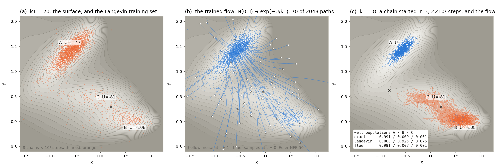

**The bracket** is quadrature above and the N(0, I) prior below:

| kT = 20, n = 2048 | p_A / p_B / p_C | ⟨U⟩ | ΔF_AB | energy (× floor) |
|---|---|---|---|---|
| quadrature (exact) | 0.806 / 0.129 / 0.065 | −113.6 | −36.6 | 1× |
| Langevin training set | 0.844 / 0.101 / 0.054 | −112.6 | −42.4 | 4.1× |
| flow, Euler, NFE 50 | 0.834 / 0.103 / 0.063 | −112.4 | −41.9 | **3.2×** |
| ↳ reweighted by p₂₀/p_θ | 0.805 / 0.129 / 0.066 | −112.8 | −36.7 | — |
| DDPM, DDIM, NFE 50 | 0.895 / 0.059 / 0.046 | −114.7 | −54.4 | 18× |
| N(0, I) prior | 0.419 / 0.195 / 0.385 | 57.2 | −15.3 | 306× |

**The result.** The raw model is faithful to its training set and to nothing else. It over-weights
well A because the chains do: over four training seeds it puts 0.832–0.843 there, which is the
data's bias reproduced.

**The lever** is the density. Reweighting the model's own samples by p₂₀/p_θ recovers the
quadrature row: every basin within 0.008 of exact and ΔF_AB within 1.5 across the four seeds, at
an effective sample size of 1,740–1,895 of 2,048. Reweighted to kT = 8, where a Langevin chain
started in well B never crosses in 2×10⁵ steps, the model gives 0.991 / 0.008 / 0.001 against the
exact 0.991 / 0.009 / 0.001. Reflow makes a one-step generator at 4.9× the floor, against 233×
for a one-step sampler under independent coupling.

**What this is not:** a molecule. The surface is two-dimensional and its partition function is a
grid sum, which is what makes every row checkable.

Detail: `runs/2026-09-11-boltzmann-generator/`, `runs/2026-10-27-boltzmann-seeds/`,
`planning/boltzmann_generator_demo.md`. `MainDiffusion2d.lean` also still holds the four
point-cloud targets of `planning/archive/diffusion_2d_demo.md`.

---

## Signal processing — gravitational-wave detection on LIGO strain

**The question.** Can a chapter CNN compete with the detector its field already has? A
binary-black-hole merger is a chirp sweeping from 25 Hz to a few hundred in under a second. The
detector to beat is the matched filter, whose detection probability in stationary Gaussian noise
is a closed form. The net is Chapter 4's `CIFAR-CNN8-wide-BN` with a two-channel stem and a
two-way head, 0.83M parameters, on one constant-Q spectrogram per detector of a whitened 2 s
window. Six epochs take under two minutes on one card.

```bash
# in .venv-gw (gwosc, gwpy, pycbc): O3a H1+L1 from GWOSC, whitened; IMRPhenomD chirps injected at SNR 4–20
.venv-gw/bin/python scripts/datasets/preprocess_gw.py --pairs=26 --val-pairs=6 --out=data/gw
lake run demo gw arm=real  net=cifar8w epochs=6 tag=real          # trained on the real strain
lake run demo gw arm=gauss net=cifar8w epochs=6 tag=gauss         # trained on Gaussian noise colored by the same PSD
python3 scripts/demos/gw_metrics.py table --gate                  # the matched filter against its closed form
python3 scripts/demos/gw_metrics.py matrix gauss=<prefix> real=<prefix>
```

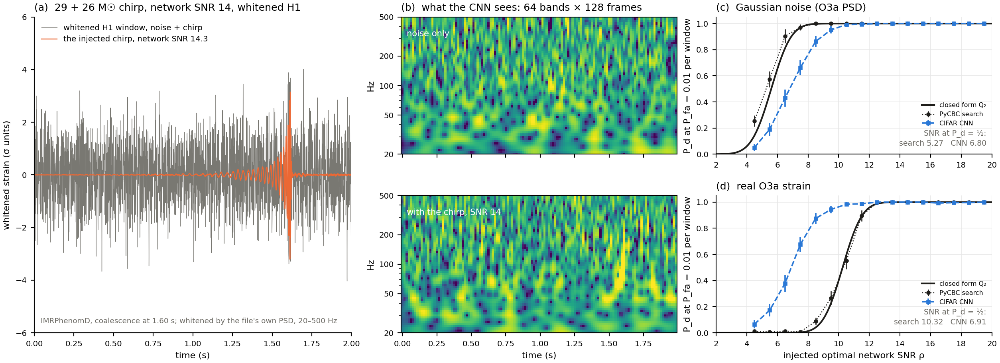

(a) A whitened H1 window with its injected chirp. (b) The spectrograms the CNN sees. (c) Detection
probability against injected network SNR in Gaussian noise. (d) The same in real O3a noise.

The data is real detector noise carrying a signal we chose: O3a strain from H1 and L1, cut into
2 s windows, with a PyCBC chirp (masses uniform in [10, 50] M☉) injected into half the training
windows at a network SNR uniform in [4, 20]. Two noise sets share every window and injection:
Gaussian noise colored by the same PSD, and the strain itself. 40,760 training and 12,228
validation windows.

**The bracket** is the matched filter, and it is checked against its theorem first: with the
known template and arrival time it reaches half detection at SNR 4.68 against the closed form's
4.75. ρ½ is the injected network SNR at which half the injections are detected:

| trained on | ρ½ on Gaussian, FAR 10⁻² | ρ½ on real, 10⁻² | ρ½ on real, 10⁻³ |
|---|---|---|---|
| CNN, Gaussian noise | 6.80 | 7.17 | 18.7 |
| CNN, real O3a strain | 6.65 | **6.91** | **7.52** |
| matched filter, quadrature sum | **5.27** | 10.32 | — |

**The result.** In Gaussian noise the filter wins, as the theorem says it must. In real noise it
loses five units of SNR to glitches at a false-alarm rate of 10⁻², and the CNN trained on real
strain reaches half detection at 6.91 where the filter needs 10.32. At 10⁻³ the filter has no row
without a veto, and the network still reaches half detection at 7.52.

**The lever** is training on the real detector. That is what teaches the glitch tail: the net
trained on Gaussian noise needs SNR 18.7 at 10⁻³.

**What this is not:** a search pipeline. The filter here runs without a glitch veto, and the
injections are ours.

Detail: `runs/2026-09-11-gw-cifar8w-real/`, `runs/2026-09-11-gw-cifar8w-gauss/`,
`runs/2026-09-11-gw-gate1/`, `planning/gw_detection_demo.md`.

---

## Representations — neural quantum states on the transverse-field Ising chain

**The question.** Can a network be a wavefunction? ψ_θ(σ) maps a spin configuration to a
log-amplitude, and the loss is the energy of the transverse-field Ising chain
(H = −J Σ σᶻᵢσᶻᵢ₊₁ − h Σ σˣᵢ, periodic, with a phase transition at h = J). There is no dataset;
the training signal is the model's own local energies. One rule runs through the demo: structure
first, and the network models the rest. ψ_θ = ψ_ref · exp f_θ, where ψ_ref is the mean-field
product state, so f_θ = 0 is the floor of every table. Three residuals climb the ladder: an MLP
on ±1 spins, a ViT on patches of spins, and a GPT whose conditionals are the wavefunction and are
sampled exactly by the TinyGPT loop.

```bash
python3 scripts/demos/nqs_metrics.py gate                              # enumeration vs Jordan-Wigner
export LEAN_MLIR_MEM_FRACTION=0.1
lake run demo ising mlp N=12 h=1.0 steps=4000 lr=0.003 cosine          # 50 s, exact gradient
lake run demo ising vit N=12 h=1.0 steps=4000 lr=0.001 cosine          # 82 s
lake run demo ising gpt N=12 h=1.0 steps=4000 lr=0.003 cosine check    # 330 s, + the sampler gate
lake run demo ising gpt N=64 h=1.0 p=4 steps=2000 lr=0.003 cosine      # ~20 min, 1024 chains
python3 scripts/demos/nqs_metrics.py score GPT=.lake/build/nqs_ising_gpt_n12_h100_metrics.json --gate
```

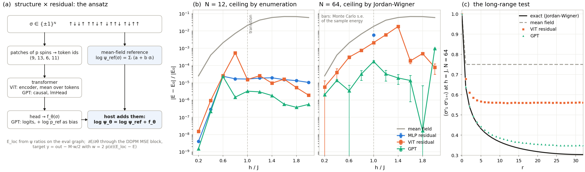

**The bracket** is mean field below and a closed form above: enumeration of all 4096
configurations at N = 12, and the Jordan-Wigner free-fermion solution at N = 64.

| h = J | params | N = 12: (E − E0)/\|E0\| | params | N = 64: (E − E0)/\|E0\| |
|---|---:|---:|---:|---:|
| mean field (floor) | 0 | 2.1e-02 | 0 | 1.8e-02 |
| MLP residual | 5,057 | 1.6e-05 | 8,385 | 5.9e-03 |
| ViT residual | 25,825 | 1.5e-05 | 26,529 | 2.1e-03 |
| GPT, 2000 steps at N = 64 | 25,956 | 3.3e-06 | 27,056 | 1.7e-04 |
| exact | — | 0 | — | 0 |

**The result.** At N = 12 every rung is three to four orders below the floor, and the GPT is the
best of them at every field: within 3.3 × 10⁻⁶ of the exact energy at the critical point. At
N = 64 the ladder separates.

**The lever** at scale is exact sampling. The GPT draws independent samples from its own
conditionals and stays at 1e-5 to 1e-4 across the field sweep. The ViT on Metropolis chains is
ten to a thousand times worse at the same parameter count and step budget.

The reference matters where it is right. For the same ViT, starting from the mean-field state
rather than the uniform one is worth three orders of magnitude at h = 0.2 and nothing at h = J.
And a low variance with a wrong energy means the wrong state: the ViT at N = 12, h = 0.8 sits in
the symmetry-broken half of the finite-N cat state, and the symmetrized reference (`symref`)
takes it to 2.0e-5.

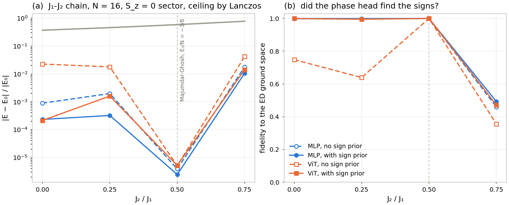

**What this is not:** a solver for frustrated systems. `model=j1j2` swaps in the J1-J2 Heisenberg
chain, whose ground state has signs. Past the Majumdar-Ghosh point every arm stalls at 1e-2 with
fidelity below 0.6, and more capacity does not move it. The sign structure is the open problem.

Detail: `runs/2026-09-11-nqs-ising/`, `planning/transformer_wavefunction_demo.md`.

---

## Structure — a distogram ResNet against the CASP16 field

**The question.** How far does the pre-AlphaFold-2 recipe get on a single sequence today? A frozen
protein language model (ESM-2 3B) supplies per-residue features and its own contact map. `pairTile`,
the AlphaFold-1 / trRosetta stem as one `Layer`, tiles them into an L×L pair map. The chapter
residual body at stride 1 (16 units, 128 channels) predicts a 66-bin distance histogram per
residue pair and trRosetta's three orientation heads. `casp16_fold.py` descends the histograms
into a trace, and `casp16_score.py` scores it the way CASP16 scored the field. Training data is
every PDB chain released before CASP16 opened, 26,310 chains; the targets are CASP16's 84 Phase-1
evaluation units, 78 of them folded. One new layer and one new proof item
(`LeanMlir/Proofs/Foundation/PairTile.lean`); the language model is outside the proof.

```bash
P=.venv-casp/bin/python
scripts/datasets/download_casp16.sh       # sequences, structures, the score table, US-align, OST
$P scripts/datasets/casp16_chain_list.py search && $P scripts/datasets/casp16_chain_list.py fetch \
  && $P scripts/datasets/casp16_chain_list.py cluster && $P scripts/datasets/casp16_chain_list.py purge
$P scripts/datasets/casp16_fetch_chains.py
$P scripts/datasets/casp16_labels.py --orient
$P scripts/datasets/casp16_embed.py --model esm2_t36_3B_UR50D --out emb3b --half --pool-out --shard 0/4   # × 4 cards
$P scripts/datasets/casp16_embed.py --model esm2_t36_3B_UR50D --out emb3b --half --pair-out --max-pairs 400000
$P scripts/datasets/casp16_targets.py --model esm2_t36_3B_UR50D --out targets_esm3b --device cpu
$P scripts/datasets/casp16_pack.py --features esm3b --sets targets,valsub && $P scripts/datasets/casp16_pack.py --features esm3b --pair-only
lake run demo casp smoke                  # FD check on the pair tile + eval ≡ train
lake run demo casp train list=train_full fs=esm3b dim=2569 epochs=100 batch=16 ch=128 units=16 crop=96 pair=1 orient=1 seed=1 tag=e100-esm3b-crop96-pair1-orient   # 21 h, one 4060 Ti
runs/2026-10-02-distogram-ablations/finish_run.sh 0 list=train_full fs=esm3b dim=2569 crop=96 ch=128 units=16 pair=1 orient=1 tag=e100-esm3b-crop96-pair1-orient   # predict → assemble → fold → score
$P scripts/demos/casp16_esmfold.py --window 800       # the ESMFold reference row
$P scripts/demos/casp16_table.py --field              # every arm placed in the field
```

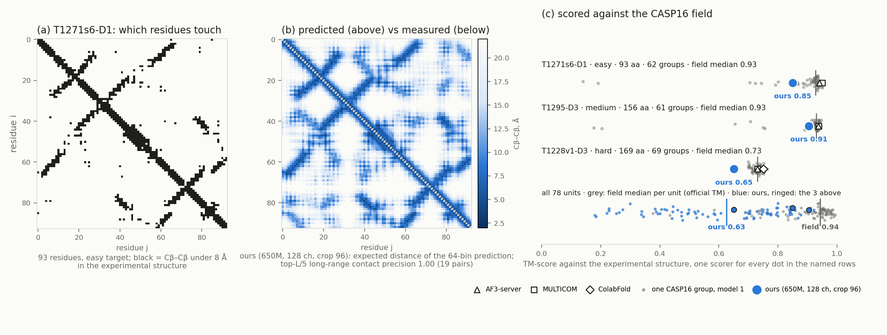

**The bracket** is a net with no language model below, and above it ESMFold (the same language
model under its own trunk) and the CASP16 field. Top-L/5 long-range contact precision over the 84
units; the fold's Cβ-lDDT and TM-score over the 78:

| arm | precision | Cβ-lDDT | TM |
|---|---:|---:|---:|
| one-hot residues, no language model, 64 ch | 0.252 | 0.319 | 0.228 |
| ESM-2 650M features, 64 ch, crop 64, 30 ep | 0.838 | 0.569 | 0.572 |
| 3B + its contact plane, 128 ch, crop 96, 30 ep | 0.880 | 0.622 | 0.632 |
| **+ orientation heads, 100 ep (the book run)** | 0.873 | **0.627** | **0.646** |
| ESMFold v1 | | 0.751 | 0.778 |
| CASP16 field, median first model per unit | | | 0.892 |

**The result.** The fold reaches TM 0.646. That is the field's 3rd percentile, against a median
model at 0.892, and the gap is the story. ESMFold is +0.132 TM and better on 71 of 78 units.

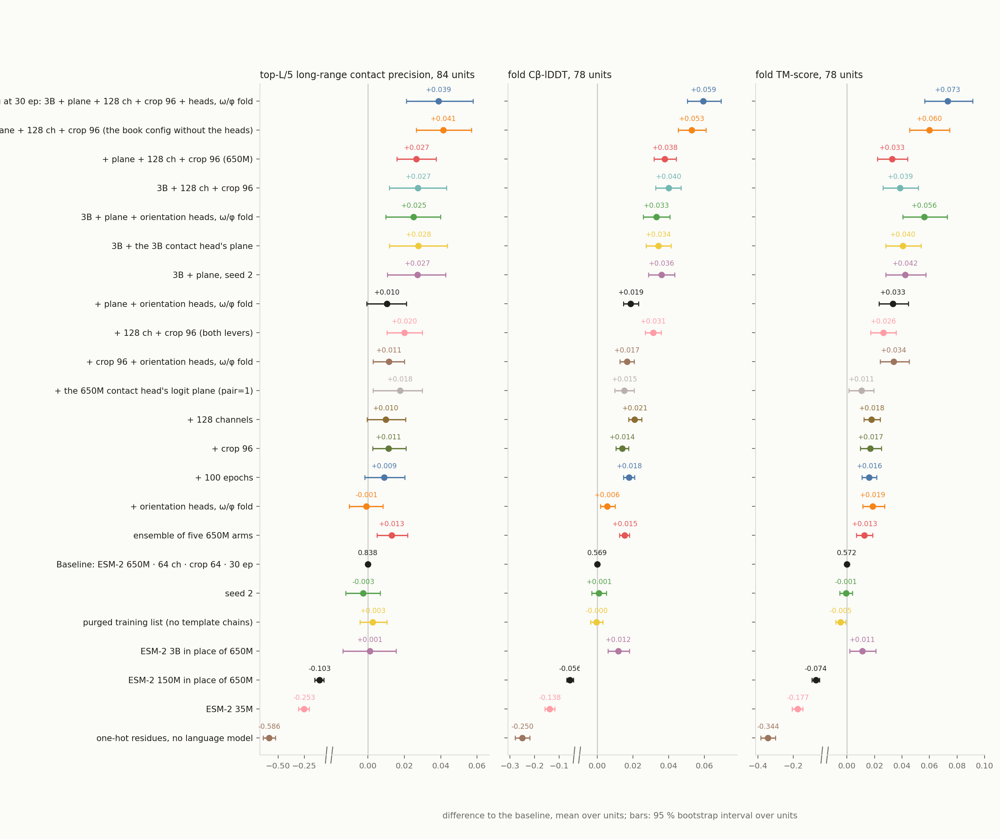

**The lever** is the language model. Contact precision goes 0.585 → 0.735 → 0.838 → 0.840 from
ESM-2 35M to 3B at fixed width and schedule. The language model's own contact map as a pair
channel is the cheapest addition (+0.018). The 100-epoch schedule buys nothing over 30, seeds move
an arm by at most 0.002, and the fold is converged: the true trace has higher energy than our fold
under our own potential on 78 of 78 units, so the map is the ceiling.

**What this is not:** one of the field's models. It reads a single sequence, and the field reads
alignments. Of the gap, the head is the larger half and the alignment is the other.
`figures/casp16_ablation_full.png` has all 23 arms.

Detail: `runs/2026-10-02-distogram-ablations/`, `planning/casp16_distogram_demo.md` (§10 the
ablation table, §11 the review, §11a the parked MSA route).

---

## Reinforcement learning — DQN from pixels on Pong, Deep CFR on Leduc poker, AlphaZero and MuZero on tic-tac-toe

Three games written in Lean, each with its own exact instrument: Chapter 13 of the book. Four
rungs: DQN from pixels on Pong, regret minimization under hidden information on Leduc hold'em,
self-play and tree search on tic-tac-toe, and the same game without its rules. MuZero is the one
rung with a codegen piece of its own, a VJP module that returns the input cotangent. Every other
rung goes through the stack's rank-2 MSE block with a host-built target.

### DQN from pixels on Pong

**The question.** Does a network reading frames learn as well as one handed the state?
`LeanMlir/Pong.lean` is Pong in about 200 lines: 84×84 render, frame skip 4, a scripted opponent,
deterministic from a seed. `MainPongDqn.lean` is Mnih et al.'s loop on it: replay 100k, ε from 1
to 0.1 over 100k agent steps, a target copy every 1,000 updates, batch 32, Adam 1e-4, 500k agent
steps. `mode=pixels k=4` is Chapter 3's CNN kit on a stack of four frames. `mode=state` is the
six-number twin, a 6→64→64→3 MLP.

```bash
lake run demo pong env 100                   # the baselines, games per arm
lake run demo pong dqn mode=pixels k=4       # DQN from frames, 27 min on one card
lake run demo pong dqn mode=state            # the six-number twin; width= and k= are its arms
```

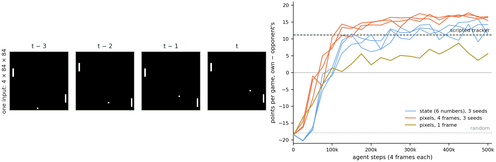

| arm | points per game (20 games, ε 0.05) | first positive eval |
|---|---|---|
| random | −17.88 ± 0.20 | — |
| scripted tracker | +11.18 ± 0.37 | — |
| pixels, 1 frame | +4.60 ± 1.48 | 100k |
| state, 6 numbers, width 64, seeds 1–3 | +14.15 / +12.70 / +13.50 | 100–125k |
| — four states stacked, width 64, seeds 1–3 | +13.45 / +9.20 / +10.55 | 150–225k |
| — one state, width 512, seeds 1–3 | +16.85 / +12.75 / +14.65 | 75–100k |
| pixels, 4 frames, seeds 1–3 | +15.60 / +15.90 / +14.90 | 75–100k |

**The result.** Pixels beat the 64-wide state twin on every seed (+15.47 against +13.45) and at
every opponent speed. The twin was meant to be the ceiling.

**The lever** is width. Widening the one-state MLP to the pixel net's dense width, 512, closes the
gap: +14.75 against +15.47, less than the wide net's own seed spread. The ordering was the 64-wide
MLP's capacity. Stacking four states costs the state net 2.4 points, since the vector already
carries the velocity. One frame cannot see velocity, and scores +4.6.

**What this is not:** Atari. The opponent is a script and the game is ours.

Detail: `runs/2026-09-25-pong-dqn/`, `runs/2026-10-27-pong-state-arms/`,
`planning/pong_dqn_demo.md`.

### Deep CFR on Leduc hold'em, scored by exact exploitability

**The question.** Can a network learn to bluff? Leduc hold'em (`LeanMlir/Leduc.lean`) is a
two-player, fixed-limit poker with one private card, one public card and two betting rounds. It is
the smallest game here with hidden information, so the answer is a mixed strategy: an equilibrium
raises a jack it knows is losing about a fifth of the time, because never bluffing is exploitable.
`MainDeepCfrLeduc.lean` is Brown, Lerer, Gross & Sandholm's Deep CFR (2019). Each iteration, the
advantage net gives the current strategy at every information set, 1,000 external-sampling
traversals write regrets to a reservoir, and the net is retrained from scratch on it. After 100
iterations a strategy net is trained; SD-CFR (Steinberger 2019), the exact average of the hundred
stored profiles, comes for free. The net is three dense layers of 64 (10.5k parameters).

```bash
lake run demo leduc env            # the exact instrument, CFR+ / DCFR, the scripted arms, Gate 0; seconds, no GPU
lake run demo leduc env r=13       # the same on a 26-card deck
lake run demo leduc cfr            # Deep CFR, ~6 min a seed; r=, T=, K=, seed=, tag=
```

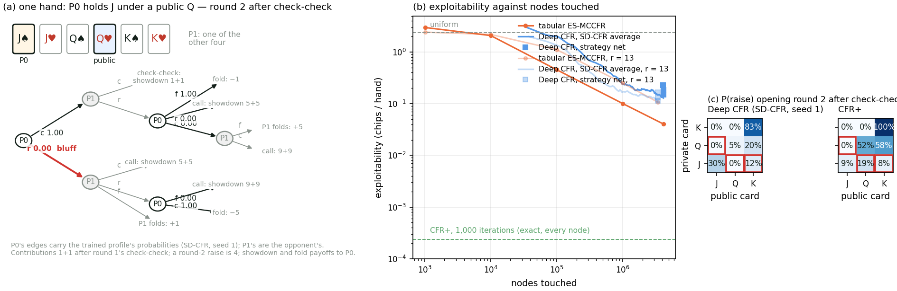

**The bracket** is exact. Suits never matter in Leduc, so the game is solved at rank level (288
information sets at three ranks): best response, exploitability and CFR+ to 1,000 iterations take
25 ms. Before anything trains, the Lean game is checked against the C tree on every terminal
history and against OpenSpiel's payoffs and exploitability. Chips per hand, ante 1, three seeds
for the learned rows:

| arm | exploitability | raise with J under Q after check-check |
|---|---|---|
| uniform random | 2.3736 | 50% |
| scripted honest | 1.050 | 0% |
| CFR+ with its bluffs removed | 0.1856 | 0% |
| Deep CFR, strategy net (4.1M nodes) | 0.229 / 0.185 / 0.152 | 1.6% / 0.8% / 6.4% |
| Deep CFR, SD-CFR average (4.1M nodes) | 0.127 / 0.150 / 0.109 | 0.0% / 5.5% / 6.3% |
| tabular ES-MCCFR at the same 4.1M nodes | 0.038 / 0.043 / 0.041 | 9.5% / 11.7% / 2.2% |
| CFR+, 1,000 iterations | 0.00024 | 19.5% |

**The result.** Deep CFR's exploitability falls from 1.4 at iteration 5 to 0.11–0.15 at 100 under
the SD-CFR readout. That is under the honest script and under CFR+ with its bluffs removed, and it
sits on the published curve. It does not beat a sampled table at the same budget on the classic
deck.

**The lever** is the size of the game. At 3 ranks the table is 3.1× less exploitable than the
net, at 6 ranks 2.0×, and at 13 ranks (5,148 information sets) 1.0×, where the net is the better
head-to-head. The net's error does not grow with the number of sets; the table's noise at a fixed
budget does.

**What this is not:** poker at the paper's scale. Leduc has six to twenty-six cards, and the
instrument that makes every row exact does not reach hold'em.

Detail: `runs/2026-10-08-deep-cfr-leduc/`, `planning/leduc_deep_cfr_demo.md`.

### AlphaZero on tic-tac-toe, scored against the solved game

**The question.** How much of a game does self-play learn, measured against all of it?
`MainAlphaZeroTtt.lean` is Silver et al.'s self-play loop on n×n tic-tac-toe with k in a row
(`LeanMlir/TicTacToe.lean`). Each iteration plays 256 games in lockstep, with a PUCT search of 25
(3×3) or 100 (4×4) simulations at every move over the net's priors and value. The visit
distribution and the outcome are the targets. The net is AlphaGo's plain conv + ReLU stack at
tic-tac-toe width, with policy and value merged into one output: 78k parameters at 3×3 and 155k
at 4×4.

```bash
lake run demo ttt env n=4                                              # the solved game, scripted pairings, the solver's gates
lake run demo ttt alphazero n=3                                        # 20 iterations, 2.5 min on one card
lake run demo ttt alphazero n=4 iters=40 sims=100 sweep=50000 epochs=5 # 10 min
```

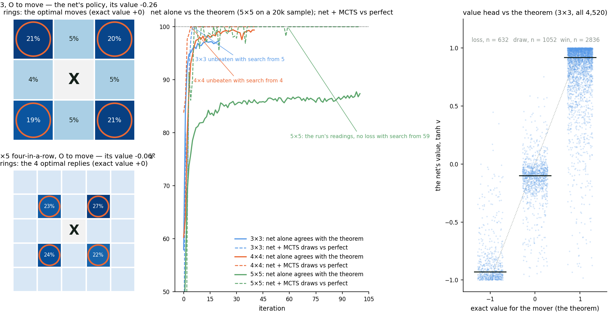

**The bracket** is the solved game. A memoized minimax fills the exact value and optimal-move set
of every position: 5,478 reachable at 3×3 and 9,722,011 at 4×4. The net is scored by whether its
top move is optimal over every decision position, and by 256 games each side against a perfect
player. At 5×5 with four in a row there is no table; an on-demand exact solver scores a 20,000
position sample.

| arm | 3×3 agree | vs perfect X · O (W/D/L) | 4×4 agree | vs perfect X · O | 5×5 (k=4) agree | vs perfect X · O |
|---|---|---|---|---|---|---|
| random | 58.0% | 0/207/793 · 0/33/967 | 60.4% | 0/487/513 · 0/341/659 | 45.0% | 0/0/200 · 0/0/200 |
| win-or-block | 94.0% | 0/831/169 · 0/215/785 | 95.6% | 0/930/70 · 0/840/160 | 77.0% | 0/7/193 · 0/1/199 |
| **net alone** | **97.3%** | 0/768/0 · 0/768/0 | **99.4%** | 0/768/0 · 0/768/0 | **87.4%** | 0/768/0 · 0/708/60 |
| net + search | — | 0/768/0 · 0/768/0 | — | 0/768/0 · 0/768/0 | — | 0/768/0 · 0/745/23 |
| perfect | 100% | 0/1000/0 · 0/1000/0 | 100% | 0/1000/0 · 0/1000/0 | 100% | 0/200/0 · 0/200/0 |

**The result.** The net alone agrees with the solved game on 97.3% of 3×3 and 99.4% of 4×4
positions and never loses to a perfect player at either. At 4×4 that is 99.4% of 9.06 million
positions learned from the 1.2% of them self-play visited. Most misses are forced wins not taken,
in positions a competent opponent never produces. At 5×5 the net never loses as X and still loses
as O: 60 of 768 alone, 23 with search.

**The lever** is the search. With 25 or 100 simulations the net is unbeaten from iteration 5
(3×3) and 4 (4×4), before the net alone is (11 and 10).

The value head estimates self-play and not the theorem. Its sign agrees with the exact value on
90% (3×3) and 96% (4×4) of positions, and it is worst on lost 4×4 positions (59%), which self-play
almost never produces.

**What this is not:** the bestiary's tower. `Bestiary/AlphaZero.lean`'s conv-BN-residual body is
the wrong instrument on nine binary cells, where BatchNorm's batch statistics are a liability.

Detail: `runs/2026-09-29-alphazero-ttt/`, `planning/alphazero_ttt_demo.md`.

### MuZero on tic-tac-toe — the same game without its rules

**The question.** Did MuZero learn tic-tac-toe, or only its values? AlphaZero's search is handed
the rules. `MainMuZeroTtt.lean` (Schrittwieser et al. 2020) learns a model of them and searches
inside the model. Four conv stacks: a representation h from the stone planes to a latent, a
dynamics g from a latent and a move to the next latent, a two-headed prediction f, and a reward
net r. 137k parameters at 3×3 and 141k at 4×4, trained end to end on K = 5 unrolled moves. The
real rules mask the root's moves and nothing inside the tree. Win rate cannot tell this agent from
AlphaZero, since both are unbeaten, so the solved game scores the model itself.

The unroll needs g's backward to hand a cotangent to the previous step. `MlirCodegen.generateVjp`
is the existing backward walk with the first layer's input gradient returned, and
`generateApplyAdam` is the Adam update on its own. The composed gradients agree with `jax.grad`
of the same loss.

```bash
# 3×3, 10 min on one card
lake run demo ttt muzero n=3 iters=60 steps=300 sims=50 qnorm=0 initSeed=301 seed=3 tag=init301
# 4×4, the same binary, 27 min
lake run demo ttt muzero n=4 iters=120 steps=300 sims=50 qnorm=0 sweepN=20000 initSeed=301 seed=3 tag=init301
# the model's report card on the saved net
lake run demo ttt muzero n=4 mode=score qnorm=0 sims=25 seed=11 scoreN=20000 tag=init301 \
    params=.lake/build/muzero_ttt_4x4_init301_params.bin
```


Left: one 4×4 line played only inside the model along five random legal moves, with the cells the
model has lost in red. Middle: agreement with the solved game against imagined depth. Right: the
reward net's recall and a board probe's accuracy against depth.

**The bracket** is AlphaZero's row under the same protocol, plus columns only a model can have:
the policy's agreement after five imagined moves (on the agent's own lines · on random lines), and
the share of winning moves r calls at one move.

| arm | 3×3 agree | imagined, own · random | r | vs perfect X · O | 4×4 agree | imagined, own · random | r | vs perfect X · O |
|---|---|---|---|---|---|---|---|---|
| AlphaZero alone | **97.3%** | — | — | 0/768/0 · 0/768/0 | **99.4%** | — | — | 0/768/0 · 0/768/0 |
| MuZero alone | 96.9% | 100% · 96.5% | 93.0% | 0/768/0 · 0/768/0 | 98.7% | 100% · 92.9% | 99.5% | 0/768/0 · 0/768/0 |
| MuZero + latent search | — | — | — | 0/768/0 · 0/768/0 | — | — | — | 0/768/0 · 0/768/0 |

**The result.** 98.7% root agreement at 4×4 and unbeaten on both sides, alone and with search.
The model knows the board where the agent plays. A linear probe refit on g's latents recovers
99.7% of whole 4×4 boards after five imagined moves on the agent's own lines, and 55% on random
lines. The reward net calls 99.5% of winning moves at one move; along random lines its recall
falls to 45% by the fifth.

**The lever** is patience. AlphaZero's 4×4 net passes 93% agreement by iteration 4. MuZero's sits
at 62–66% through iteration 40 and reaches 98% by 100, because self-play stays decisive for a long
time and the outcomes teach the values of weak play.

**What this is not:** the paper's search. The paper's min–max-normalized Q (`qnorm=1`, the
default) never passed the 3×3 gate at this budget; AlphaZero's raw mean Q did on every init. The
recipe is `steps=300 sims=50 qnorm=0`.

Detail: `runs/2026-10-20-muzero-ttt-4x4/`, `runs/2026-10-16-muzero-ttt/` (the 3×3 study),
`planning/muzero_ttt_demo.md`.

---

## Layout

The demos above are the maintained set. Everything else lives in a subfolder. Moving a file does
not change its executable name, so every `lake exe <name>` in this repo, in `scripts/` and in CI
still works.

```
demos/
├── README.md                              # this file
├── figures/                               # rendered outputs for the README
├── visdrone/                              # the PyTorch references for the VisDrone detector (its own README)
│
│   # ── the demos, in Chapters 11–13's order ──
├── MainYolov1VisdroneFpn.lean             # R34+FPN detector on VisDrone, train + infer
├── MainYolov1NeuDetFpn.lean               # the same detector on NEU-DET steel defects
├── MainYolov1NeuDet448.lean               #   and the single-grid arm beside it
├── MainAraslSigns.lean                    # chapter-4 CNN on ArASL sign-language letters, random vs blocked split
├── MainPlantLeaf.lean                     # chapter-5 R34 on PlantVillage → PlantDoc, CAM + Shapley
├── MainRsBands.lean                       # chapter-4 CNN on EuroSAT's 13 bands under five stems, scored on Brazil
├── MainUnetBratsR34.lean                  # R34-UNet on BraTS
├── MainUnetBratsTrain.lean                # from-scratch UNet on BraTS
├── MainBratsPredict.lean                  # render predicted masks from a checkpoint
├── MainBratsEval.lean                     # per-patient Dice, the BraTS papers' protocol
├── MainTinyGptShakespeare.lean            # char-level transformer
├── MainBigramShakespeare.lean             # bigram baseline (validates the data pipeline)
├── MainMnistDdpmTrain.lean / Sample       # DDPM on MNIST (Sample also writes the trajectory figure)
├── MainLidcDenoiseTrain.lean / Sample     # low-dose CT synthesis on LIDC: MSE / Noise2Noise / conditional DDPM
├── MainDiffusion2d.lean                   # 2-D diffusion + flow matching: the Boltzmann generator
├── MainGwDetect.lean                      # chapter-4 CNN vs the matched filter on LIGO O3a strain
├── MainNqsIsing.lean                      # neural quantum states: MLP/ViT/GPT wavefunctions on the Ising chain
├── MainDistogramCasp.lean                 # distogram ResNet on frozen ESM-2 features, scored against CASP16
├── MainPongEnv.lean                       # the scripted baselines over LeanMlir/Pong.lean
├── MainPongDqn.lean                       # DQN from the six-number state or 84×84 frames
├── MainLeducEnv.lean                      # Leduc hold'em: the exact instrument, the scripted arms, Gate 0 (no GPU)
├── MainDeepCfrLeduc.lean                  # Deep CFR on that game, scored by exact exploitability
├── MainTttEnv.lean                        # tic-tac-toe n×n: the solved game, scripted players, the solver's gates (no GPU)
├── MainAlphaZeroTtt.lean                  # AlphaZero self-play + PUCT, scored against the solved game
├── MainMuZeroTtt.lean                     # MuZero: a learned model, PUCT in the latent, the model scored
│
├── probes/                                # gates and tools; type-checked in CI (`lake build Apps`), run by hand
│   ├── MainFpnLossProbe.lean              #   finite-difference gate on the detector loss
│   ├── MainFpnNeckProbe.lean              #   FPN neck shapes
│   ├── MainFpnDetectProbe.lean            #   detector head
│   ├── MainFpnTrainEmit.lean              #   emit the detector train step
│   ├── MainAnchorLossProbe.lean           #   anchor loss
│   ├── MainDiouLossProbe.lean             #   DIoU box loss
│   ├── MainSegLossProbe.lean              #   segmentation losses
│   ├── MainGradFdProbe.lean               #   generic finite-difference gradient check
│   ├── MainVjpProbe.lean                  #   the VJP module against the train step, FD and jax.vjp
│   ├── MainFlashProbe.lean                #   flash-attention
│   ├── MainMnistDdpmScore.lean            #   DDPM sample scoring (`lake run demo ddpm score`)
│   └── MainGradCAM.lean                   #   closed-form CAM for GAP+dense nets
│
└── archive/                               # superseded; kept building, not maintained
    └── MainYolov1VisDrone448.lean         #   the single-grid VisDrone detector the FPN replaced
```

Each section links its plan: the active ones sit at `planning/` top level, the finished ones in
`planning/archive/`.
